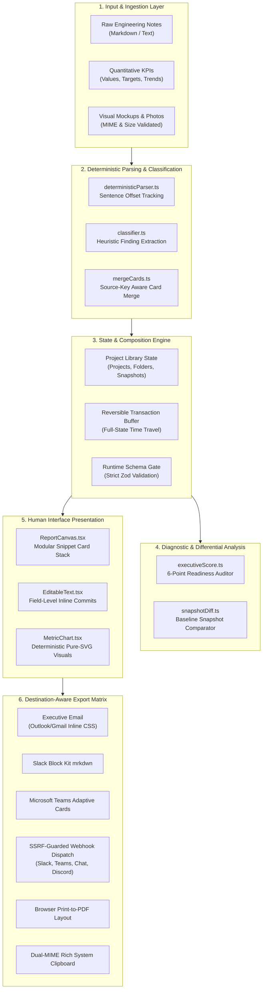

# Project Reporting Builder

<p align="center">
  
</p>

<h3 align="center">Modular, Truth-Preserving Executive Status Intelligence</h3>

<p align="center">
  A client-side workspace engineered to synthesize unstructured technical updates, numerical KPIs, and visual assets into modular, executive-ready Snippet Cards. Crafted with Apple Human Interface Guidelines (HIG) visual discipline, strict deterministic parsing, and zero-telemetry local privacy.
</p>

<p align="center">
  
  
  
  
  
  
  
</p>

---

## Table of Contents

- [1. Design Philosophy: The Apple Way](#1-design-philosophy-the-apple-way)
- [2. System Architecture](#2-system-architecture)
- [3. Key Architectural Features](#3-key-architectural-features)
  - [3.1. Truth-Preserving Deterministic NLP Engine](#31-truth-preserving-deterministic-nlp-engine)
  - [3.2. Modular Snippet Card Ecosystem](#32-modular-snippet-card-ecosystem)
  - [3.3. Pure-SVG Metric Visualizations](#33-pure-svg-metric-visualizations)
  - [3.4. Explainable Executive-Readiness Auditor](#34-explainable-executive-readiness-auditor)
  - [3.5. Time Flow & Baseline Snapshot Differential Engine](#35-time-flow--baseline-snapshot-differential-engine)
  - [3.6. Destination-Aware Multi-Channel Export](#36-destination-aware-multi-channel-export)
  - [3.7. Zero-Trust Security & SSRF-Protected Webhooks](#37-zero-trust-security--ssrf-protected-webhooks)
  - [3.8. Internationalization (i18n) & Accessibility](#38-internationalization-i18n--accessibility)
- [4. Directory Structure](#4-directory-structure)
- [5. Getting Started](#5-getting-started)
- [6. Keyboard Navigation & Ergonomics](#6-keyboard-navigation--ergonomics)
- [7. Design Tokens & Design System](#7-design-tokens--design-system)
- [8. Quality Assurance & Test Verification](#8-quality-assurance--test-verification)
- [9. License](#9-license)

---

## 1. Design Philosophy: The Apple Way

Project Reporting Builder is built upon the fundamental tenets of Apple platform engineering:

| Principle | Engineering Manifestation |
| :--- | :--- |
| **Visual Restraint** | Uncluttered, high-contrast canvas utilizing system tokens (`#F5F5F7` canvas, `#FFFFFF` surfaces, `#1D1D1F` labels). Replaces dense, noisy pill badges with typography-driven hierarchy and unboxed, natural grouping. |
| **Truth-Preserving Determinism** | Operates exclusively via deterministic linguistic parsing and sentence offset tracking. Never extrapolates, hallucinates, or fabricates uncommitted delivery dates, metrics, or owners. |
| **Directly Responsible Individuals (DRI)** | Embraces Apple's organizational accountability model by enforcing explicit DRI attribution across action items and commitments. |
| **Privacy by Default** | 100% on-device processing. No analytical beacons, no telemetry tracking, and zero cloud storage leakage. All state resides locally inside strict, validated storage schemas. |
| **Direct Manipulation & Fluidity** | Interactive card canvas with field-level transactional editing, drag-and-drop continuous reordering, instant undo/redo reversibility, and micro-animated feedback. |

---

## 2. System Architecture

The application is structured into decoupled, single-responsibility layers adhering to clean architectural patterns:



---

## 3. Key Architectural Features

### 3.1. Truth-Preserving Deterministic NLP Engine
Unlike generative AI models that risk hallucinating timeline estimates or misconstruing blockers, the extraction pipeline relies on explicit grammatical rule sets implemented in [`src/lib/parsing/deterministicParser.ts`](./src/lib/parsing/deterministicParser.ts):
- **Sentence Offset Mapping:** Computes exact `[start, end]` character bounds for every sentence extracted from raw notes.
- **Passage Traceability:** Every generated card carries a `SourceReference` link (`passageText`, confidence score: `explicit` | `inferred` | `manual`). Clicking any card instantly spotlights and highlights the exact originating passage in the composer.
- **Unconfirmed Status Gating:** Scans for ambiguous delivery language (*"not yet confirmed"*, *"TBD"*, *"pending confirmation"*) and converts them into explicit status warnings rather than assuming completion.

### 3.2. Modular Snippet Card Ecosystem
Cards are strictly modeled as a discriminated union over `type` in [`src/types/report.ts`](./src/types/report.ts) and validated at runtime via [`src/schemas/reportSchema.ts`](./src/schemas/reportSchema.ts):
1. **Executive Summary Card (`executive_summary`):** High-level bottom-line delivery summary, bulleted accomplishments, and unconfirmed commitment disclosures.
2. **KPI Metric Card (`kpi_metric`):** Quantitative indicator pairing current value, delta, target, previous baseline, and automated directional health evaluation.
3. **Risk & Blocker Card (`risk_blocker`):** Critical defect and blocker tracking with standardized severity levels (`critical`, `high`, `medium`, `low`), impact assessment, and explicit mitigation ownership.
4. **Next Steps Card (`next_steps`):** Granular action items with lifecycle status (`planned`, `in_progress`, `completed`), delivery dates, and Directly Responsible Individual (DRI) attribution.
5. **Milestone Card (`milestone`):** High-watermark delivery milestones with status flags (`achieved`, `on_track`, `at_risk`, `delayed`).
6. **Media Card (`visual_update`):** High-fidelity architectural diagrams, UI mockups, and telemetry charts with descriptive alt text adhering to WCAG AA accessibility standards.

### 3.3. Pure-SVG Metric Visualizations
Zero reliance on bulky third-party chart libraries. Metric representations in [`src/components/cards/MetricChart.tsx`](./src/components/cards/MetricChart.tsx) and [`src/lib/export/metricGraphs.ts`](./src/lib/export/metricGraphs.ts) are rendered using deterministic pure SVG and HTML table primitives:
- **Bar Chart:** Zero-baseline aware relative progress bar with target marker ticks and prior-period markers.
- **Donut Chart:** Mathematical SVG circular progress ring computed using `stroke-dasharray` and `stroke-dashoffset` geometry with percentage center readout.
- **Trend Chart:** Step-line visualization comparing baseline to current velocity.
- **Big Number:** Minimalist typography-first headline readout.

### 3.4. Explainable Executive-Readiness Auditor
Implemented in [`src/lib/analysis/executiveScore.ts`](./src/lib/analysis/executiveScore.ts), the diagnostic engine grades project reports against a 6-point enterprise readiness standard:
- **Check 1: Executive Summary Presence:** Ensures executive stakeholders receive an immediate overview.
- **Check 2: Unconfirmed Release Commitments:** Flags speculative or unanchored schedule targets.
- **Check 3: Defined Reporting Period:** Verifies temporal boundaries for metrics and progress.
- **Check 4: Metric Target Benchmark Clarity:** Requires quantitative metrics to define baseline targets.
- **Check 5: Action Item Ownership & DRIs:** Flags unassigned action items missing a clear owner.
- **Check 6: Image Accessibility (WCAG AA Alt Text):** Enforces descriptive alternative text on visual assets.
*Includes a one-click automated Quick-Fix applicator that remediates missing fields inline.*

### 3.5. Time Flow & Baseline Snapshot Differential Engine
Located in [`src/lib/analysis/snapshotDiff.ts`](./src/lib/analysis/snapshotDiff.ts) and [`src/components/projects/TimeFlow.tsx`](./src/components/projects/TimeFlow.tsx), the snapshot system facilitates longitudinal project reporting:
- **Streamlined Snapshot Creation:** Apple-styled snapshot card with inline naming, keyboard shortcuts (<kbd>↵</kbd> save, <kbd>Esc</kbd> cancel), and automatic timestamping.
- **Auto-Navigation on Card Creation:** Adding a card manually automatically navigates and smoothly scrolls the canvas directly to the newly created card with active inspection highlight.
- **Immutable Historical Snapshots:** Captures complete project states with chronological timestamps and manual/automatic origin tagging.
- **"What's Changed?" Comparison:** Automatically computes deltas between any historical baseline and the current draft:
  - Discovered key accomplishments
  - Numerical metric drift (`+/- %` and directional improvement)
  - Resolved risks vs. newly introduced critical blockers
  - Completed vs. outstanding action item commitments

### 3.6. Destination-Aware Multi-Channel Export
Unified format preview and message dispatch dialog enabling instant one-click delivery across corporate destinations:
- **Executive Email:** Self-contained, responsive HTML table structure with inline CSS conforming to Outlook and Gmail layout rendering engines.
- **Direct Mail Client Compose:** One-click launch with prefilled executive HTML body into **Default Mail App** (Apple Mail / Thunderbird), **Gmail Web**, and **Outlook Web**.
- **Slack Message:** Native Slack Block Kit and formatted `mrkdwn` with visual emojis and quote blocks.
- **Microsoft Teams:** Adaptive Cards payload and formatted markdown blocks.
- **Google Chat:** Structured card representation with formatted section widgets.
- **Discord:** Rich webhook embed format with categorized field layouts.
- **Formal Weekly Status Memo:** Clean typographic memo for C-suite executive circulation.
- **GitHub Flavored Markdown:** Clean Markdown document with headers, checklists, and tables.
- **Print-to-PDF Engine:** Print stylesheet (`@media print`) stripping UI chrome, sidebars, and composer panels to produce print-perfect paginated PDFs.
- **Dual-MIME System Clipboard:** Writes `text/html` and `text/plain` simultaneously to the macOS/Windows clipboard via the modern `navigator.clipboard.write([new ClipboardItem(...)])` API.

### 3.7. Zero-Trust Security & SSRF-Protected Webhooks
- **SSRF Prevention:** [`src/lib/security/webhookValidation.ts`](./src/lib/security/webhookValidation.ts) inspects outbound webhook URLs, enforcing HTTPS and strictly prohibiting calls to `localhost`, `127.0.0.1`, `::1`, `0.0.0.0`, `*.local`, and RFC 1918 private IPv4 subnets (`10.0.0.0/8`, `172.16.0.0/12`, `192.168.0.0/16`).
- **XSS Sanitization:** Previews and HTML exports pass through [`src/lib/security/sanitize.ts`](./src/lib/security/sanitize.ts) powered by DOMPurify with an explicit tag and attribute whitelist that permits inline SVG charts while stripping executable scripts.
- **Asset Boundaries:** Uploaded images are restricted to explicit MIME types (`image/png`, `image/jpeg`, `image/webp`, `image/svg+xml`) with a hard 5MB memory guard.
- **Strict Content Security Policy (CSP):** Configured in `index.html` to restrict resource origins, execution contexts, and connection targets.

### 3.8. Internationalization (i18n) & Accessibility
- **Full Tri-Locale Localization:** Comprehensive translation dictionaries in [`src/lib/i18n/dictionaries.ts`](./src/lib/i18n/dictionaries.ts) supporting **English (`en`)**, **Traditional Chinese (`zh-Hant`)**, and **Simplified Chinese (`zh-Hans`)**.
- **Dynamic BCP-47 Tagging & Date Localization:** Updates document `<html lang>` and regional date formatting dynamically.
- **WCAG 2.1 AA Standards:** Semantic HTML landmarks (`<main>`, `<aside>`, `<section>`, `<article>`), high contrast text ratios, and ARIA modal focus trapping (`useDialogFocus`).
- **Motion Accessibility:** Complete `prefers-reduced-motion` handling, suppressing animations across UI transitions and the animated tour character Pip.

---

## 4. Directory Structure

```text
Apple-POC-Project-Reporting-Builder/
├── docs/
│   ├── architecture.md             # System architecture & engineering specification
│   ├── manual_test_checklist.md    # End-to-end browser verification checklist
│   └── workspace-experience.md     # Document-first UX workflow documentation
├── src/
│   ├── App.tsx                     # Main application container & workspace orchestration
│   ├── main.tsx                    # React 19 root bootstrap & LanguageProvider
│   ├── index.css                   # Tailwind v4 directives, Apple glass, print stylesheets
│   ├── types/
│   │   └── report.ts               # Discriminated union SnippetCard domain models
│   ├── schemas/
│   │   └── reportSchema.ts         # Runtime Zod validation contracts
│   ├── design/
│   │   └── tokens.ts               # Apple HIG design tokens (color, typography, radius, shadow)
│   ├── hooks/
│   │   ├── useCardOperations.ts    # Card manipulation, selection, and mutation logic
│   │   ├── useKeyboardShortcuts.ts # Global keybinding listener
│   │   ├── useMediaQuery.ts        # Responsive viewport detection
│   │   ├── useProjectLibrary.ts    # Multi-project, folder, and snapshot state management
│   │   ├── useToast.ts             # Notification toast management
│   │   └── useUndoRedo.ts          # Generic reversible state history hook
│   ├── components/
│   │   ├── cards/                  # Modular card presentation components
│   │   │   ├── CardRenderer.tsx    # Universal container with quick action rails
│   │   │   ├── ExecutiveSummaryCard.tsx
│   │   │   ├── KpiMetricCard.tsx
│   │   │   ├── MetricChart.tsx     # Pure-SVG bar, donut, trend, and number visuals
│   │   │   ├── MilestoneCard.tsx
│   │   │   ├── NextStepsCard.tsx
│   │   │   ├── RiskBlockerCard.tsx
│   │   │   └── VisualUpdateCard.tsx
│   │   ├── common/                 # Reusable UI primitives
│   │   │   ├── EditableText.tsx    # Field-level inline editing with keyboard commits
│   │   │   ├── LanguageSwitcher.tsx# Locale selector dropdown
│   │   │   ├── ShortcutsModal.tsx  # Keyboard shortcuts cheat-sheet
│   │   │   ├── Toast.tsx           # Floating accessible toast alerts
│   │   │   └── useDialogFocus.ts   # Accessible modal focus trap & escape dismissal
│   │   ├── composer/               # Report intake and bottom composer
│   │   │   └── ChatComposer.tsx    # Multi-line notes intake, metrics, and asset dropper
│   │   ├── composition/            # Canvas curation & comparison
│   │   │   ├── ReportCanvas.tsx    # Primary report staging canvas
│   │   │   ├── ReportingDate.tsx   # Localized calendar date selector
│   │   │   ├── SnapshotComparisonModal.tsx # "What's Changed?" diff visualizer
│   │   │   └── SortableCard.tsx    # Reorderable card wrapper with accessible reorder
│   │   ├── export/                 # Export modal and tool dispatching
│   │   │   └── ExportModal.tsx     # Destination previews, downloads, and webhooks
│   │   ├── guided-demo/            # Interactive onboarding walkthrough
│   │   │   ├── GuidedTour.tsx      # Modal tour container
│   │   │   ├── TourCharacter.tsx   # Animated vector companion (Pip)
│   │   │   └── tourSteps.ts        # 6-step interactive tutorial definitions
│   │   ├── layout/
│   │   │   └── Header.tsx          # Apple navigation bar, save state, and actions
│   │   └── projects/
│   │       ├── ProjectSidebar.tsx  # Project tree, folders, and library navigator
│   │       └── TimeFlow.tsx        # Snapshot timeline and comparison triggers
│   ├── lib/
│   │   ├── analysis/
│   │   │   ├── executiveScore.ts   # 6-point readiness scoring & auto quick-fixes
│   │   │   └── snapshotDiff.ts     # Baseline vs. current differential engine
│   │   ├── composition/
│   │   │   ├── mergeCards.ts       # Source-key preserving card merger
│   │   │   └── mergeReviewedCards.ts
│   │   ├── export/
│   │   │   ├── clipboard.ts        # Dual-MIME rich clipboard writer
│   │   │   ├── destinationFormatters.ts # Slack, Teams, Email, Memo, Webhook generators
│   │   │   ├── executiveEmail.ts   # Table-based inline CSS email renderer
│   │   │   ├── htmlExport.ts       # Standalone escaped HTML exporter
│   │   │   ├── jsonExport.ts       # Validated JSON project serialization
│   │   │   ├── markdownExport.ts   # GitHub-flavored Markdown generator
│   │   │   └── metricGraphs.ts     # Email-safe ASCII and table metric visualizers
│   │   ├── i18n/
│   │   │   ├── LanguageContext.tsx # React Context provider for i18n
│   │   │   └── dictionaries.ts     # Complete en, zh-Hant, and zh-Hans string tables
│   │   ├── integrations/
│   │   │   ├── messageDispatch.ts  # Webhook delivery and dispatch audit logging
│   │   │   └── scheduledDispatch.ts# Background send scheduler
│   │   ├── parsing/
│   │   │   ├── classifier.ts       # Heuristic sentence classifier & extractor
│   │   │   └── deterministicParser.ts # Rule-based parser with offset tracking
│   │   ├── persistence/
│   │   │   ├── localDraft.ts       # Resilient localStorage serializer
│   │   │   └── projectLibrary.ts   # Multi-project library schema & operations
│   │   ├── security/
│   │   │   ├── sanitize.ts         # DOMPurify HTML sanitizer & image URL validator
│   │   │   └── webhookValidation.ts# HTTPS & SSRF boundary protection
│   │   ├── logger.ts               # Structured client-side logging utility
│   │   └── sampleData.ts           # Enterprise modernization sample project
│   └── test/                       # Vitest comprehensive unit & integration suite
│       ├── classifier.test.ts
│       ├── differentiators.test.ts
│       ├── emailGraphs.test.ts
│       ├── export.test.ts
│       ├── integrations.test.ts
│       ├── metricChart.test.ts
│       ├── parsing.test.ts
│       ├── projectLibrary.test.ts
│       ├── reordering_and_persistence.test.ts
│       ├── scheduledDispatch.test.ts
│       ├── security.test.ts
│       ├── validation.test.ts
│       └── workspaceFlow.test.ts
├── index.html                      # Entry HTML with Content-Security-Policy
├── package.json                    # Project dependencies & scripts
├── tsconfig.json                   # Strict TypeScript compiler options
└── vite.config.ts                  # Vite 8 configuration with Tailwind v4
```

---

## 5. Getting Started

### Prerequisites

- **Node.js**: v18.0.0 or later (Node 20+ or Node 22 LTS recommended)
- **Package Manager**: `npm`, `pnpm`, or `bun`

### Installation

1. Clone the repository:
   ```bash
   git clone https://github.com/Dreamaker183/Apple-POC-Project-Reporting-Builder.git
   cd Apple-POC-Project-Reporting-Builder
   ```

2. Install dependencies:
   ```bash
   npm install
   # or
   bun install
   ```

3. Launch the development server:
   ```bash
   npm run dev
   ```
   The application will be accessible at `http://localhost:3000`.

### Production Build

Compile optimized production assets to `dist/`:
```bash
npm run build
```

Preview the production build locally:
```bash
npm run preview
```

---

## 6. Keyboard Navigation & Ergonomics

Engineered with macOS keyboard ergonomics for rapid curation without lifting your hands from the keyboard:

| Key Combination | Action |
| :--- | :--- |
| <kbd>⌘</kbd> + <kbd>\</kbd> / <kbd>Ctrl</kbd> + <kbd>\</kbd> | Toggle Projects & Time Flow Sidebar |
| <kbd>⌘</kbd> + <kbd>Z</kbd> / <kbd>Ctrl</kbd> + <kbd>Z</kbd> | Undo last report action |
| <kbd>⇧</kbd> + <kbd>⌘</kbd> + <kbd>Z</kbd> / <kbd>Ctrl</kbd> + <kbd>Y</kbd> | Redo report action |
| <kbd>⌘</kbd> + <kbd>↵</kbd> / <kbd>Ctrl</kbd> + <kbd>↵</kbd> | Synthesize & Update Report from Composer Notes |
| <kbd>⌘</kbd> + <kbd>E</kbd> / <kbd>Ctrl</kbd> + <kbd>E</kbd> | Open Destination-Aware Export Dialog |
| <kbd>⌘</kbd> + <kbd>P</kbd> / <kbd>Ctrl</kbd> + <kbd>P</kbd> | Open Browser Print-to-PDF Engine |
| <kbd>Alt</kbd> + <kbd>↑</kbd> / <kbd>↓</kbd> | Move currently focused card up or down in order |
| <kbd>↵</kbd> (in single-line field) | Commit inline text edit |
| <kbd>⌘</kbd> + <kbd>↵</kbd> (in multi-line field) | Commit multi-line text edit |
| <kbd>Esc</kbd> | Cancel inline edit / Close modal dialog |
| <kbd>?</kbd> | Open Keyboard Shortcuts Cheat-Sheet |

---

## 7. Design Tokens & Design System

The visual language strictly mirrors Apple's Human Interface Guidelines, defined in [`src/design/tokens.ts`](./src/design/tokens.ts):

### Color Tokens
- **Canvas Background:** `#F5F5F7` (Light) / `#000000` (Dark)
- **Surface Elevation:** `#FFFFFF` (Light) / `#1C1C1E` (Dark)
- **Primary Label:** `#1D1D1F` (Light) / `#F5F5F7` (Dark)
- **Secondary Label:** `#6E6E73` (Light) / `#8E8E93` (Dark)
- **System Accent:** `#0071E3` (Light) / `#0A84FF` (Dark)
- **Glass Vibrancy:** `rgba(255, 255, 255, 0.78)` with `backdrop-filter: blur(20px) saturate(180%)`

### Typography Hierarchy (SF Pro System Font)
- **Large Title:** 34px / Bold / Tracking +0.37px
- **Title 1:** 28px / Bold / Tracking +0.36px
- **Title 2:** 22px / Bold / Tracking +0.35px
- **Title 3:** 20px / Semibold / Tracking +0.38px
- **Headline:** 17px / Semibold / Tracking -0.41px
- **Body:** 17px / Regular / Tracking -0.41px
- **Footnote / Caption:** 13px / Regular / Tracking -0.08px

---

## 8. Quality Assurance & Test Verification

The codebase is protected by comprehensive test suites executing against Vitest:

```bash
npm test
```

### Verification Results: 100% Pass Rate
- **15 Test Suites Passed** (103 / 103 tests passing)
  - [`src/test/classifier.test.ts`](./src/test/classifier.test.ts): Linguistic pattern matching & heuristic classification
  - [`src/test/differentiators.test.ts`](./src/test/differentiators.test.ts): Differential snapshot comparator & card diffing
  - [`src/test/editableWords.test.ts`](./src/test/editableWords.test.ts): Word and phrase-level inline transactional editing
  - [`src/test/emailGraphs.test.ts`](./src/test/emailGraphs.test.ts): Outlook/Gmail inline CSS metric graph rendering
  - [`src/test/export.test.ts`](./src/test/export.test.ts): Markdown, HTML escaping, and destination formatting
  - [`src/test/guidedTour.test.ts`](./src/test/guidedTour.test.ts): Interactive 6-step guided walkthrough & tour state machine
  - [`src/test/integrations.test.ts`](./src/test/integrations.test.ts): Webhook payload generation & dispatch audit logging
  - [`src/test/metricChart.test.ts`](./src/test/metricChart.test.ts): SVG bar, donut, trend, and number math validations
  - [`src/test/parsing.test.ts`](./src/test/parsing.test.ts): Sentence offset boundaries & fact extraction
  - [`src/test/projectLibrary.test.ts`](./src/test/projectLibrary.test.ts): Folder hierarchy, project lifecycle, and snapshot immutability
  - [`src/test/reordering_and_persistence.test.ts`](./src/test/reordering_and_persistence.test.ts): Card reordering, local draft persistence, and executive scoring
  - [`src/test/scheduledDispatch.test.ts`](./src/test/scheduledDispatch.test.ts): Scheduled dispatch execution lifecycle
  - [`src/test/security.test.ts`](./src/test/security.test.ts): SSRF prevention, private IP rejection, and XSS sanitization
  - [`src/test/validation.test.ts`](./src/test/validation.test.ts): Strict Zod runtime schema boundaries
  - [`src/test/workspaceFlow.test.ts`](./src/test/workspaceFlow.test.ts): End-to-end composer-to-canvas integration flow

Static type checking:
```bash
npm run lint
```

---

## 9. License

This project is licensed under the Apache 2.0 License. See the header notices across source files for licensing terms.
